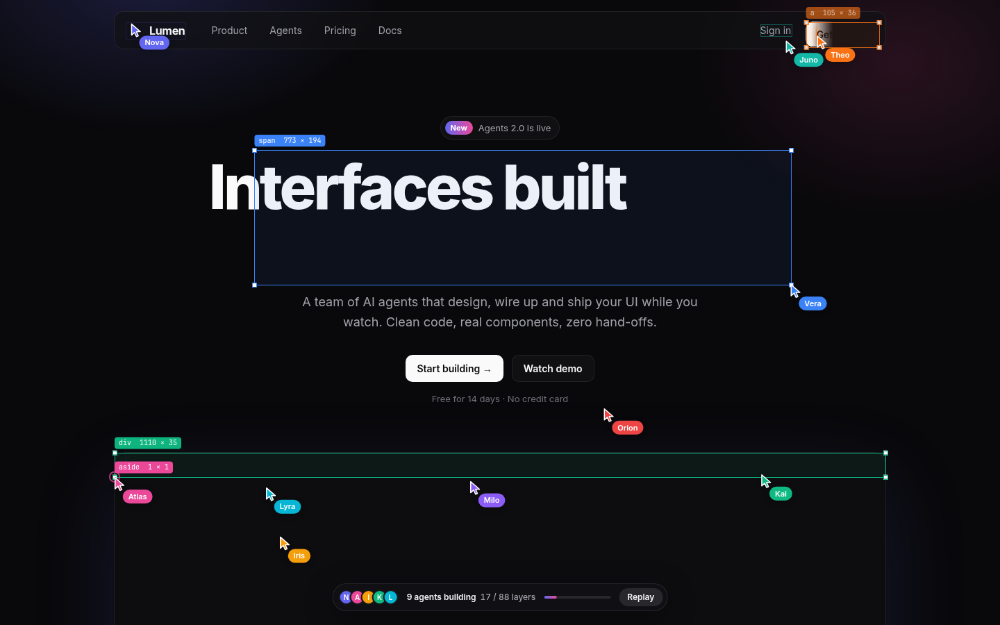

<div align="center">

# agent-build

**A team of named cursor agents builds your website in front of you.**

Drop-in page-intro animation for any website: plain HTML, React, Next.js, Vue or Svelte.
No dependencies · ~12 KB gzipped · works on existing sites without changing your markup.

[**Live demo →**](https://sajidalee1.github.io/agent-build/)



</div>

---

## What it does

When the page loads, a few cursor "agents" (Nova, Atlas, Iris…) fly in. They work through your page piece by piece: each one drags a Figma-style selection box over a piece, then reveals it with a soft wipe while the cursor glides along its edge. When the whole page is built, the agents line up and rise in a wave while the page scrolls back to the top, then fly off the screen.

- **Zero setup on existing sites.** It finds the pieces automatically: text, buttons, cards, images, SVGs, inputs, anything with a background, border or shadow.
- **Safe.** If anything goes wrong it reveals the whole page immediately; content is never left hidden. The page ends exactly as it started.
- **Respectful of visitors.** Scrolling pauses auto-follow, and the agents come to whatever is on screen. The build pauses in background tabs, and `prefers-reduced-motion` skips the animation.
- **Scales.** Huge pages (thousands of elements) are grouped automatically into about 150 steps and fit into about 20 seconds.

---

## Quick start

### 1. Any website: one line, no build step

Paste this into your `<head>`:

```html
<script src="https://cdn.jsdelivr.net/gh/SajidAlee1/agent-build@v0.1.0/agent-build.js" data-body data-agents="8" data-hud></script>
```

That's it. The whole page is built by the agents on every load.

### 2. Only one section

```html
<script src="https://cdn.jsdelivr.net/gh/SajidAlee1/agent-build@v0.1.0/agent-build.js"></script>

<agent-build agents="6" hud>
  <section> …your hero, pricing table, dashboard… </section>
</agent-build>
```

### 3. React

```bash
npm install github:SajidAlee1/agent-build
```

```jsx
import { AgentBuild } from 'agent-build/react'

export default function App() {
  return (
    <AgentBuild agents={8} hud onDone={({ ms }) => console.log(`built in ${ms}ms`)}>
      <YourPage />
    </AgentBuild>
  )
}
```

### 4. Next.js (App Router)

```tsx
// app/layout.tsx
import { AgentBuild } from 'agent-build/react'   // already a client component ('use client')

export default function RootLayout({ children }: { children: React.ReactNode }) {
  return (
    <html lang="en">
      <body>
        <AgentBuild agents={8} hud>{children}</AgentBuild>
      </body>
    </html>
  )
}
```

It's safe to import during server rendering: nothing runs until the component mounts in the browser. Server components inside `children` keep working.

### 5. Vue / Svelte / vanilla JS

```js
import { attach } from 'agent-build'

// Vue:    onMounted(async () => { builder = await attach(rootRef.value, { agents: 8 }) })
// Svelte: onMount(async () => { builder = await attach(node, { agents: 8 }) })
const builder = await attach(document.querySelector('#app'), { agents: 8, hud: true })

builder.rebuild()   // play again
builder.destroy()   // stop and show everything
```

---

## Options

| Option | HTML attribute | Default | What it does |
|---|---|---|---|
| `agents` | `agents` / `data-agents` | `8` | Number of agents (1–40) |
| `speed` | `speed` | `1` | Minimum speed multiplier |
| `duration` | `duration` | `20` | Target build time in seconds; big pages speed up to fit (`0` = never) |
| `maxLayers` | `max-layers` | `150` | Most pieces to build; smaller bits are grouped into their parent |
| `names` | `names` | built-in | `false` / `"off"` hides name tags, or your own list: `"Ali,Sara,Zain"` |
| `colors` | `colors` | built-in | Your own colours: `"#6366f1,#ec4899"` |
| `hud` | `hud` / `data-hud` | `false` | Show the status pill with progress and a Replay button |
| `trigger` | `trigger` | `"load"` | `"visible"` starts when scrolled into view, `"manual"` waits for `.play()` |
| `follow` | `follow` | `true` | Auto-scroll the page with the build (`"off"` to disable) |
| `finale` | `finale` | `true` | Wave ending that scrolls back to the top (`"off"` to disable) |

**Per element**

| Attribute | Effect |
|---|---|
| `data-ab-skip` | Never touch this element or anything inside it (e.g. a cookie banner or chat widget) |
| `data-ab-layer` | Build this element as a single piece instead of splitting it |

**Events.** `agentbuild:done` fires on the root with `detail: { ms, layers }`. In React, use `onDone`.

---

## How it behaves

| Situation | What happens |
|---|---|
| Visitor scrolls during the build | Auto-follow pauses, the agents build what's on screen first, and following resumes 2.5 s after they stop |
| Tab hidden / window minimised | The build freezes and continues exactly where it stopped |
| `prefers-reduced-motion` | No animation; content shows immediately |
| Script error or very slow page | Everything is revealed immediately |
| Sticky or fixed headers | Built as one piece |
| Off-canvas menus, hidden dropdowns, carousel slides off-screen | Ignored |
| Huge DOM (thousands of nodes) | Grouped into about 150 steps |
| React StrictMode / fast refresh | Mounts cleanly, never leaves a stray overlay |

---

## Tested on

The automated test (`test/run.mjs`) drives Chromium on real websites. It checks that every piece gets built, nothing is left hidden or styled, the final page matches the original, frames stay smooth, and a visitor scrolling mid-build keeps control of the page.

| Site | Pieces built | Build time | Left hidden | Final page vs. original* | Visitor-scroll test |
|---|---|---|---|---|---|
| example.com | 8 / 8 | 3.1 s | 0 | 0.9997 | n/a (too short) |
| Wikipedia article | 146 / 146 | 19.9 s | 0 | 0.986 | ✅ |
| Hacker News | 146 / 146 | 15.7 s | 0 | 1.000 | ✅ |
| MDN docs | 145 / 145 | 20.2 s | 0 | 1.000 | ✅ |
| GitHub | 131 / 131 | 21.8 s | 0 | 0.996 | ✅ |
| Tailwind CSS | 147 / 147 | 20.4 s | 0 | 0.996 | ✅ |
| Stripe | 148 / 148 | 25.4 s | 0 | 0.950 | ✅ |
| Vercel | 150 / 150 | 15.4 s | 0 | 0.998 | ✅ |
| App shell (fixed sidebar, inner scrolling) | 50 / 50 | 13.9 s | 0 | 0.908 | ✅ |
| Tricky CSS (sticky, body grid, carousel, RTL, forms) | 38 / 38 | 11.8 s | 0 | 0.999 | ✅ |
| Huge shop (4,800 elements) | 142 / 142 | 17.6 s | 0 | 1.000 | ✅ |

\*Similarity of before/after screenshots (1.000 = identical). Lower scores come from the sites' own videos, carousels and live content changing between the two screenshots. The agents' own work costs about 2–4 ms per frame on these sites.

Run it yourself:

```bash
git clone https://github.com/SajidAlee1/agent-build && cd agent-build
npm test                 # headless, writes screenshots + results.json to test/out/
npm run test:visible     # opens a real Chromium window so you can watch every site
node test/run.mjs test/out https://your-site.com   # test your own site
```

Requires Node 18+ and Chromium (`chromium` on your PATH).

---

## Local demo

```bash
npm run demo     # then open http://localhost:8080
```

`index.html` is the demo landing page and `test/` has edge-case pages (an app shell with inner scrolling, tricky CSS, a huge DOM, React).

---

## Publishing to npm (maintainers)

```bash
npm login                          # once, opens the browser
npm version patch                  # bump 0.1.0 → 0.1.1 (creates a git tag)
npm publish --access public
git push --follow-tags
```

After publishing, people can use `npm install agent-build` and the CDN links `https://unpkg.com/agent-build` / `https://cdn.jsdelivr.net/npm/agent-build`.

---

## License

[MIT](LICENSE) © 2026 Sajid Ali
